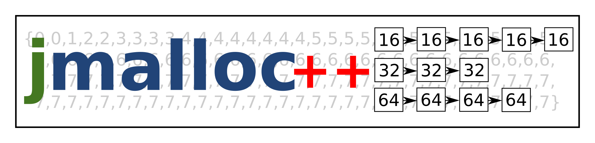

# cppjmalloc

cppjmalloc is a memory allocator for C++ that's on a completely different
location of the high performance - low fragmentation scale than most allocators
out there. While most allocators waste CPU cycles to save memory, cppjmalloc
saves CPU cycles by wasting memory. It purposefully has an interface slightly
different from other allocators. The difference is that cppjmalloc does not
store the allocated block size anywhere, so the calling program needs to pass
the block size when freeing a block. However, all standard C++ allocator
interfaces used by the STL containers for example know and pass the allocated
block size when freeing the memory, so this interface difference of cppjmalloc
is a natural fit for the C++ programming language.

The allocator is a header-only library, easy to be integrated to any project.
It is fully compatible with the standard C++ library. The test application
demonstrates its use. The allocator depends on cppmoveptralloc which is used as
a submodule, and is too a header-only library.

The test application is compiled with stirmake. How to install it is described
in the web page of stirmake at https://github.com/Aalto5G/stirmake

When stirmake has been installed, type "smka" to compile.

The C version of jmalloc is available at https://github.com/Aalto5G/jmalloc
